<div align="center">

<!-- Animated Vector Hero Banner -->
<a href="#omnicontrol">
  
</a>

<br/><br/>

<!-- Dynamic Neon Typing SVG Animation -->
<a href="https://git.io/typing-svg">
  
</a>

<br/>

<!-- Modern Shields.io Badges -->
<p align="center">
  <a href="https://vercel.com"></a>
  <a href="https://microsoft.com/windows"></a>
  <a href="https://fastapi.tiangolo.com"></a>
  <a href="https://nextjs.org"></a>
  <a href="#acceptance-testing"></a>
  <a href="LICENSE"></a>
</p>

<!-- Quick Navigation Bar -->
<p align="center">
  <a href="#-quick-start"><b>🚀 Quick Start</b></a> •
  <a href="#-core-capabilities"><b>⚡ Capabilities</b></a> •
  <a href="#-animated-architecture"><b>📐 Architecture</b></a> •
  <a href="#-why-omnicontrol"><b>📊 Comparison</b></a> •
  <a href="#-deploying-to-vercel"><b>🌐 Vercel Deploy</b></a> •
  <a href="#-collaborating-in-isolated-environments"><b>🤝 Collaboration</b></a> •
  <a href="#-copyright--duplication-controls"><b>🛡️ License &amp; Security</b></a>
</p>


</div>

<br/>

## 🌟 Overview

**OMNICONTROL** turns your smartphone or tablet into a wireless, encrypted, low-latency command centre for your personal Windows workstation.

Designed with an ultra-sleek, dark-mode visual aesthetic inspired by **Linear**, **Raycast**, and **macOS**, OMNICONTROL pairs native Windows system management with touch-optimized remote desktop streaming. Whether you are across the room, giving a presentation, or travelling, OMNICONTROL delivers total workstation control directly from your mobile browser.

---

## ⚡ Core Capabilities

<table>
  <tr>
    <td width="50%" valign="top">
      <h3>🖥️ 1. Ultra Low-Latency Remote Desktop</h3>
      <ul>
        <li><b>Zero-Bufferbloat Flow Control:</b> Leaky-bucket <code>frame_ack</code> streaming guarantees frames never queue up in TCP buffers.</li>
        <li><b>Real Hardware Cursor Burn-in:</b> Hardware mouse cursor captured directly via Win32 <code>GetCursorInfo</code> with a glowing pinpoint reticle.</li>
        <li><b>High-Speed JPEG Acceleration:</b> Sub-1ms NEAREST interpolation and GPU <code>createImageBitmap</code> canvas rendering.</li>
      </ul>
    </td>
    <td width="50%" valign="top">
      <h3>🖱️ 2. Zero-Overlap Virtual Mouse &amp; D-Pad</h3>
      <ul>
        <li><b>Non-Occluding Split View:</b> Desktop stream remains 100% visible while virtual mouse panel docks cleanly under your thumb.</li>
        <li><b>Precision 4-Way Nudge:</b> 1-pixel micro-nudge D-pad for clicking tiny Windows buttons and titlebars.</li>
        <li><b>Full Mouse Actions:</b> Left Click, Right Click Armed mode, Drag Lock toggle, and 2-axis wheel scrolling.</li>
      </ul>
    </td>
  </tr>
  <tr>
    <td width="50%" valign="top">
      <h3>🎙️ 3. PIN-Guarded Voice AI Assistant</h3>
      <ul>
        <li><b>Security Enforcement:</b> Requires 6-digit PIN authentication before executing any voice commands.</li>
        <li><b>Natural Spoken Commands:</b> Control volume, open applications, lock screen, manage windows, or query battery status.</li>
        <li><b>Live Audio TTS Feedback:</b> Laptop speaks back with immediate status confirmations.</li>
      </ul>
    </td>
    <td width="50%" valign="top">
      <h3>🚀 4. Universal App &amp; IDE Launcher</h3>
      <ul>
        <li><b>Start Menu Indexer:</b> Auto-indexes 175+ installed Windows apps (Notepad, Calculator, Discord, Office, Zoom, etc.).</li>
        <li><b>Direct Developer Launchers:</b> 1-tap launchers for <b>Google Antigravity IDE</b>, <b>VS Code</b>, <b>PowerShell</b>, and <b>Terminal</b>.</li>
        <li><b>Live Window Switcher:</b> View all open windows; bring to front, minimize, maximize, or close remotely.</li>
      </ul>
    </td>
  </tr>
  <tr>
    <td width="50%" valign="top">
      <h3>📁 5. Chrooted File Manager &amp; Transfers</h3>
      <ul>
        <li><b>Path-Traversal Sandboxed:</b> Strict boundary validation prevents unauthorized directory traversal.</li>
        <li><b>Bi-Directional Transfer:</b> Upload files from phone to laptop and download laptop files directly to mobile storage.</li>
        <li><b>Rich Previews:</b> Instant previews for source code (syntax styled), images (high-res), text files, and PDFs.</li>
      </ul>
    </td>
    <td width="50%" valign="top">
      <h3>💻 6. Interactive PowerShell PTY</h3>
      <ul>
        <li><b>Real-Time Live Shell:</b> Bidirectional interactive Windows PowerShell stream with real-time stdout/stderr.</li>
        <li><b>ANSI Color Rendering:</b> Full xterm-style color support, command history, and Ctrl+C interrupt signals.</li>
        <li><b>Quick Snippet Drawer:</b> 1-tap buttons for <code>ipconfig</code>, <code>git status</code>, <code>tasklist</code>, and <code>systeminfo</code>.</li>
      </ul>
    </td>
  </tr>
  <tr>
    <td width="50%" valign="top">
      <h3>🔋 7. Hardware Telemetry &amp; Power Control</h3>
      <ul>
        <li><b>Live Sensor Graphs:</b> Real-time CPU % (overall &amp; per-core), RAM GB used/free, disk storage, and battery level.</li>
        <li><b>Windows Core Audio:</b> Master volume slider and instant mute toggle via <code>Pycaw</code>.</li>
        <li><b>Workstation Power:</b> Safely Lock, Sleep, Restart, or Shutdown (with PIN and safety confirmation modals).</li>
      </ul>
    </td>
    <td width="50%" valign="top">
      <h3>⚡ 8. Wake-on-LAN (WOL) Management</h3>
      <ul>
        <li><b>Hardware MAC Discovery:</b> Automatically resolves local Ethernet &amp; Wi-Fi adapter physical addresses.</li>
        <li><b>UDP Magic Packet Dispatch:</b> Broadcasts standard 102-byte WOL magic frames to port 9.</li>
        <li><b>Subnet Reachability:</b> Built-in ping probes and complete BIOS/ACPI configuration guide.</li>
      </ul>
    </td>
  </tr>
</table>

<br/>
<div align="center">
  
</div>
<br/>

## 📐 Animated Architecture

<div align="center">
  
</div>

### Low-Latency Flow Control Protocol

```mermaid
sequenceDiagram
    autonumber
    participant Mobile as 📱 Mobile Client (Next.js)
    participant Agent as 💻 Workstation Agent (FastAPI)
    participant Win32 as 🪟 Windows 11 OS Subsystem

    Note over Mobile,Agent: 🔒 Secure Pairing via 6-Digit PIN & JWT
    Mobile->>Agent: WebSocket Connect (/ws/desktop?token=...)
    Agent->>Mobile: Stream Initialized (quality=40, scale=0.50)
    
    rect rgb(10, 20, 35)
        Note over Mobile,Agent: ⚡ Leaky-Bucket Zero Bufferbloat Loop
        Agent->>Win32: Grab Screen (MSS) + Burn Cursor (GetCursorPos)
        Agent->>Mobile: Binary JPEG Frame (~40 KB)
        Mobile->>Mobile: GPU createImageBitmap() Canvas Render
        Mobile-->>Agent: {"type": "frame_ack"} (Request Next Frame)
    end

    opt User Input Interaction
        Mobile->>Agent: {"type": "mouse_move", "dx": 2.5, "dy": -1.0}
        Agent->>Win32: Subpixel Accumulator Mouse Move (0.0ms delay)
    end
```



<br/>
<div align="center">
  
</div>
<br/>

## 📊 Why OMNICONTROL?

| Feature | OMNICONTROL | TeamViewer / AnyDesk | Windows Remote Desktop (RDP) |
| :--- | :---: | :---: | :---: |
| **Mobile Client Installation** | 🚫 **None** (Instant Web PWA) | ⚠️ Required App (~150MB) | ⚠️ Required App Store Client |
| **Touchscreen Virtual Mouse** | ✅ **Nudge D-Pad + Docked Trackpad** | ❌ Awkward click emulation | ❌ Clunky pointer emulation |
| **Voice AI Control** | ✅ **PIN-guarded with spoken TTS** | ❌ None | ❌ None |
| **Direct IDE Launchers** | ✅ **Google Antigravity &amp; VS Code** | ❌ Manual navigation | ❌ Manual navigation |
| **Integrated Terminal** | ✅ **Interactive Live PowerShell PTY** | ❌ Desktop streaming only | ❌ Desktop streaming only |
| **Self-Hosted &amp; Private** | ✅ **100% Local / Zero Cloud Leak** | ❌ Proprietary Cloud Relays | ⚠️ Port-forwarding security risks |
| **Bandwidth Optimization** | ✅ **Dynamic Flow-Control (~40KB/frame)** | ⚠️ Heavy dynamic bitrate | ⚠️ Heavy video bandwidth |

<br/>
<div align="center">
  
</div>
<br/>

## 🚀 Quick Start

### 1. Prerequisites
* **Laptop:** Windows 11 (64-bit)
* **Python:** 3.12+ (in `agent/.venv`)
* **Node.js:** v20+ and npm

### 2. Launch OMNICONTROL
Run the all-in-one launcher script in PowerShell:
```powershell
.\scripts\start-all.ps1
```

Or start the services independently:
```powershell
# 1. Start Companion Agent (serves REST/WSS APIs & bundled web app on port 8000)
.\agent\.venv\Scripts\python.exe agent\main.py

# 2. (Optional) Start Next.js Development Server (port 3000)
npm --prefix apps/web run dev
```

### 3. Connect from Your Smartphone
1. Open the URL shown in your laptop terminal on your phone browser (e.g. `http://192.168.0.109:8000`).
2. Enter the **6-digit pairing PIN** shown on your laptop console.
3. Your phone is paired and granted instant workstation command!

<br/>
<div align="center">
  
</div>
<br/>

## 🌐 Deploying to Vercel

The OMNICONTROL web frontend is pre-configured for **zero-config Vercel deployment** with global edge CDN delivery.

### 1-Click Deployment
1. Import your GitHub repository into [Vercel](https://vercel.com/new).
2. Root `vercel.json` automatically configures framework detection and security headers.
3. Click **Deploy**.

### Worldwide Remote Connection via Cloudflare Tunnel (Free)
To connect your Vercel web app to your laptop securely from any cellular or Wi-Fi network:
```powershell
# 1. Install Cloudflare Tunnel CLI
winget install Cloudflare.cloudflared

# 2. Start an instant secure HTTPS tunnel to your agent
cloudflared tunnel --url http://127.0.0.1:8000
```
Copy the generated `https://...trycloudflare.com` address and paste it into the **System Profiles** switcher in your mobile app.

> For detailed deployment steps, see the complete [Vercel Deployment Guide](docs/DEPLOY_VERCEL.md).

<br/>
<div align="center">
  
</div>
<br/>

## 🤝 Collaborating in Isolated Environments

To ensure security, prevent workstation collisions, and safeguard developer privacy, all team members collaborate under the **Separate Environment Mandate**:

```
+-------------------------------------------------------------------------+
|                              GITHUB REPO                                |
|                        (Protected 'main' Branch)                        |
+--------------------+-------------------------------+--------------------+
                     |                               |
                     ▼                               ▼
       +----------------------------+  +----------------------------+
       |   CONTRIBUTOR A SANDBOX    |  |   CONTRIBUTOR B SANDBOX    |
       |                            |  |                            |
       | • Branch: feature/mouse    |  | • Branch: fix/telemetry    |
       | • Vercel: Preview Deploy A |  | • Vercel: Preview Deploy B |
       | • Local Agent: Port 8000   |  | • Local Agent: Port 8000   |
       | • DB: Local (gitignored)   |  | • DB: Local (gitignored)   |
       +----------------------------+  +----------------------------+
```

1. **Local Sandbox Isolation:** Each collaborator runs their own agent runtime on `http://127.0.0.1:8000`. The local SQLite database (`data/omnicontrol.db`) is strictly `.gitignored` so credentials and device pairings never leak.
2. **Ephemeral Vercel Previews:** Every Pull Request automatically generates a unique Vercel preview URL (`https://omnicontrol-git-<branch>.vercel.app`) for isolated frontend review.
3. **Automated CI Enforcement:** GitHub Actions automatically tests every PR against the unit test suite and validates the Next.js production build before merging.

> Review the complete guidelines in [CONTRIBUTING.md](CONTRIBUTING.md).

<br/>
<div align="center">
  
</div>
<br/>

## 🧪 Acceptance Testing

OMNICONTROL includes a 20-point automated end-to-end acceptance harness verifying every subsystem:

```powershell
# Run the complete 20/20 acceptance suite
.\agent\.venv\Scripts\python.exe scripts\verify-acceptance.py
```

<details>
<summary><b>🔍 View 20/20 Verification Acceptance Results</b></summary>
<br/>

```text
=================================================================
OMNICONTROL — FULL END-TO-END ACCEPTANCE VERIFICATION
=================================================================
[PASSED] TEST 1 (Secure Pairing & Connection): PASSED
[PASSED] TEST 2 (Real Hardware & Battery Telemetry): PASSED (CPU: 5.3%, RAM: 21.9GB, Battery: 95%)
[PASSED] TEST 3 (Live Screen Streaming): PASSED (87KB JPEG frame received)
[PASSED] TEST 4 (Touch Mouse Injection Protocol): PASSED
[PASSED] TEST 5 (Keyboard Text Typing Protocol): PASSED
[PASSED] TEST 6 (VS Code Discovery & Launch Route): PASSED
[PASSED] TEST 7 (Antigravity Discovery & Launch Route): PASSED
[PASSED] TEST 8 (Running Application Window Switcher): PASSED (17 windows enumerated)
[PASSED] TEST 9 (File Browsing & Download to Phone): PASSED
[PASSED] TEST 10 (File Upload Phone to Laptop): PASSED
[PASSED] TEST 11 (Interactive PowerShell Terminal): PASSED
[PASSED] TEST 12 (Windows Core Audio Volume Control): PASSED (Level: 60%)
[PASSED] TEST 13 (Workstation Lock Trigger): PASSED
[PASSED] TEST 14 (Restart Recovery & Windows Startup Registration): PASSED
[PASSED] TEST 15 (Wake-on-LAN Magic Packet Dispatch): PASSED
[PASSED] TEST 16 (Multi-Network IP Detection): PASSED (4 active interfaces)
[PASSED] TEST 17 (Unauthorized Access Protection): PASSED (HTTP 401 enforced)
[PASSED] TEST 18 (Precision Virtual Mouse & Trackpad Control): PASSED
[PASSED] TEST 19 (Voice Command Assistant Engine): PASSED
[PASSED] TEST 20 (Revocation Immediate Enforcement): PASSED (HTTP 403 enforced)
=================================================================
ALL ACCEPTANCE TESTS PASSED SUCCESSFULLY (20/20)
```
</details>

<br/>
<div align="center">
  
</div>
<br/>

## 🛡️ Copyright & Duplication Controls

**Copyright &copy; 2026 OMNICONTROL. All Rights Reserved.**

This software, its source code, architecture, and associated documentation are proprietary and confidential.

* **Strict Prohibition of Duplication:** No part of this codebase may be duplicated, reproduced, decompiled, reverse engineered, republished, or redistributed without express written permission.
* **No Downloading for Commercial or Derivative Clones:** Scraping or downloading this repository for the purpose of creating public mirrors, unauthorized commercial SaaS products, or AI dataset training is strictly prohibited.
* **Collaboration Exception:** Authorized contributors may fork or clone this repository solely to develop and submit improvements back to the upstream project under the terms of the [OMNICONTROL Proprietary License](LICENSE).

<br/>

---

<div align="center">
  <b>OMNICONTROL PRO</b> • Crafted with Precision for Windows 11 Workstations
  <br/>
  <sub>Protected by International Copyright and Intellectual Property Laws.</sub>
</div>
